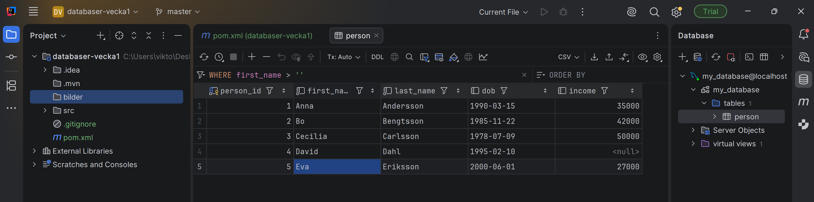
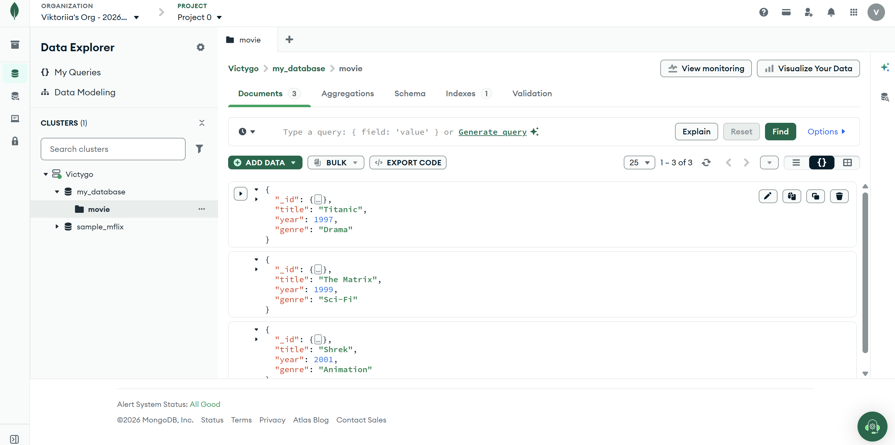
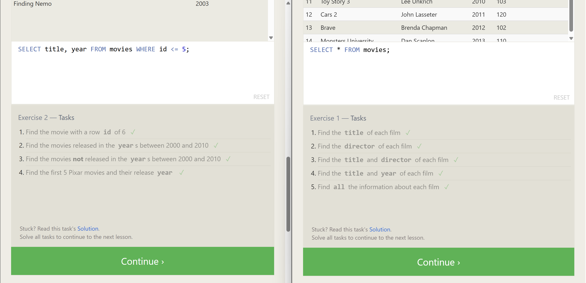

# Labb 1

# MySQL



# MongoDB



# SQL



# Frågor som ni ska svara på (G-nivå)

## Databaser och verktyg

1. Vad är en databas, och vad kan den användas till?

Svar: En databas är ett ställe där man sparar data på ett ordnat sätt, så att man snabbt kan hitta, ändra och ta bort information. Den kan användas till att spara till exempel kunder, produkter och beställningar i en webbutik, eller elever och betyg i en skola.

2. Vad används språket SQL till?

Svar: SQL används för att prata med en databas. Med SQL kan man skapa tabeller, lägga till data, hämta data, ändra data och ta bort data. Till exempel hämtar `SELECT * FROM person;` alla personer i tabellen person.

## Tabeller och relationer

3. Vad är en tabell, en rad och en kolumn?

Svar: En tabell är en samling data om samma sorts sak, till exempel personer. En rad är en post i tabellen, alltså en person, till exempel Anna Andersson. En kolumn är en egenskap som alla rader har, till exempel förnamn eller födelsedatum.

4. Vad är en primärnyckel, och varför behövs den?

Svar: En primärnyckel är en kolumn som är unik för varje rad, till exempel person_id. Den behövs för att man ska kunna skilja raderna åt. Om två personer heter Anna Andersson vet databasen ändå vilken som är vilken, eftersom de har olika person_id.

5. Vad är en främmande nyckel?

Svar: En främmande nyckel är en kolumn i en tabell som pekar på primärnyckeln i en annan tabell. Den används för att koppla ihop tabeller. Till exempel kan tabellen köp ha kolumnen kund_id som pekar på kund_id i tabellen kund.

6. Varför är det bra att lagra kunduppgifter och köp i olika tabeller?

Svar: Då sparas varje kunds uppgifter bara en gång, och köpen pekar på kunden med en främmande nyckel. Det gör att man slipper skriva samma information många gånger. Om en kund byter adress behöver man bara ändra på ett ställe, och risken för fel blir mindre.

## NoSQL

7. Vad menas med NoSQL, och hur kan information organiseras i en sådan databas?

Svar: NoSQL är databaser som inte använder tabeller med fasta kolumner som en vanlig SQL-databas. Informationen kan organiseras på olika sätt, till exempel som dokument (som JSON i MongoDB), som nyckel-värde-par eller som grafer. Dokumenten behöver inte ha exakt samma fält.

8. Ge ett exempel på när en NoSQL-databas kan vara lämplig och förklara varför.

Svar: En NoSQL-databas passar bra för en chattapp. Där sparas väldigt många meddelanden som kan se olika ut (text, bilder, emojis) och som ska sparas snabbt. I en dokumentdatabas kan varje meddelande vara ett dokument, och man behöver inte bestämma en fast struktur i förväg.

## SQL – hämta data från tabellen person

9. Hämta alla kolumner för alla personer i tabellen.

```sql
SELECT * FROM person;
```

10. Hämta endast förnamn och efternamn för alla personer.

```sql
SELECT first_name, last_name FROM person;
```

11. Hämta förnamn, efternamn och inkomst för personer med en inkomst över 30 000.

```sql
SELECT first_name, last_name, income FROM person WHERE income > 30000;
```

12. Hämta alla personer födda före den 1 januari 1990.

```sql
SELECT * FROM person WHERE dob < '1990-01-01';
```

13. Hämta förnamn, efternamn och inkomst, sorterat efter inkomst från högst till lägst.

```sql
SELECT first_name, last_name, income FROM person ORDER BY income DESC;
```

14. Räkna hur många personer som finns i tabellen.

```sql
SELECT COUNT(*) FROM person;
```